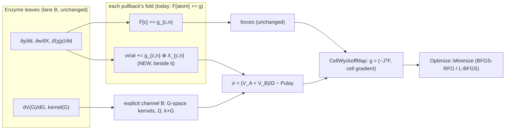

# The CELL half of level-1 relaxation: design note (lane H, 2026-11-09)

For the user, before any code.  It extends `doc/GeometryOptimizationPlan.md` §9 ("TiO₂ level 1: a, c and u through the solid
coordinate map; the cell part needs stress") and `doc/Records/CalcNetworkReview.md` §3 (`PESRequest::stress`, "the variable-cell
seam, later").  Lane H built the position half (`WyckoffMap`, `MakeSolidGeometryRun`, V-OPTIMIZE-DIP steps 1-3); this note designs
the cell half: the stress tensor, the map that adds cell parameters, its gates, and the order for rutile.

## 0. The idea in one paragraph

Strain the crystal homogeneously: every lattice vector and every atom moves by the same deformation, A → (1+ε)A and R → (1+ε)R,
at fixed density matrix D and fixed fractional k.  The stress is σ_ab = (1/Ω) ∂E/∂ε_ab at that fixed D, minus the Pulay overlap
term, exactly as a force is ∂E/∂R at fixed D minus Tr(W ∂S/∂R).

Every piece of E depends on the strain through one of TWO channels:

- **(A) RIDE.**  Some things are POINTS that move with the strain: atom centres and all their periodic IMAGES, the Becke mesh's
  atomic centres, and the raster points (the raster is fixed in fractional coordinates, so it scales with the cell).  For these, the
  strain derivative is the VIRIAL Σ_X (∂E/∂X) ⊗ X over the UNFOLDED points X.  The force code already computes every ∂E/∂X: it folds
  them into F[atom].  So channel A is ONE new out-parameter beside each existing fold, `virial += g ⊗ X`.  The Enzyme leaves are the
  same, at nearly no extra cost.
- **(B) EXPLICIT.**  Some quantities carry the cell explicitly: the reciprocal vectors G = (1+ε)^{-T} G₀, the volume Ω and every 1/Ω
  or Ω/N weight, a plane-wave orbital basis's k+G.  These are per-term formulas: the G-space kernels' dV/d|G|, the textbook
  Nielsen–Martin pieces.

Then σ = (1/Ω)(V_A + V_B) − (Pulay), where the Pulay piece is also channel A, through S.

**Why the virial is well defined.**  A periodic quantity depends on points only through their DIFFERENCES.  So Σ_X ∂E/∂X = 0
(translation invariance, the forces' own check), and the virial does not depend on the origin.  Shifting the origin is therefore a
free unit gate.  An antisymmetric ε (a rotation) must give zero, which is a second free gate.

## 1. Per term: channels, formula source, gates

The rutile production stack is GPW with GTH PPs, LDA, GPW Hartree and the Becke-mesh XC (the GPW default).  "FD" means the per-term
central difference at fixed D, with the cell and the fractional positions strained, at a non-TRIM k.

| term | channel A (ride) | channel B (explicit) | gate | oracle |
|---|---|---|---|---|
| **Ewald ion-ion** | real-space pair sum: pair virial | reciprocal sum: G-kernel, Ω, the α split | FD of the closed form; L^{-1} scaling: σ = E/(3Ω)·1 on a cubic lattice | CP2K, QE |
| **Kinetic** (Gaussian Bloch sums) | pair virial over (i, j, image n) of Σ D ∂T/∂d ⊗ d: the fold of today's kinetic pullback | none (Gaussians keep their shape) | FD; origin shift | CP2K |
| **Pulay** (overlap) | the same pair virial with W | none | FD of Tr(W S(ε)) | CP2K |
| **PP short / local closed form** | three-centre virial (two basis centres + the PP centre, all images) | none | FD; Σ g = 0 | CP2K |
| **PP non-local** (KB) | ⟨χ\|p⟩ pair virial, contracted with h and D | none | FD | CP2K |
| **V_loc long** (G-space, structure factor) | ρ̃(G)'s collocation: raster-point and Gaussian virial | dV_loc(\|G\|)/d\|G\| · G_aG_b/\|G\|, Ω | FD | CP2K |
| **Hartree, GPW** | collocation virial of ρ̃ (points and centres) | ½Ω Σ 4π\|ρ̃\|²/G²: the kernel's 2G_aG_b/G⁴, Ω | FD; the textbook −E_H/Ω on the trace for a fixed ρ̃ (a unit check of channel B alone) | CP2K |
| **XC, Becke mesh** (default) | (a) ρ at the points: χ(r_g − X) with r_g = R_A + u_g, the atomic offsets u_g NOT strained, so this is an image virial; (b) the partition weights w_g({X}): image virial of ∂w/∂X | none: the mesh rides atoms, not the cell | FD; origin shift | CP2K (needs its mesh matched; else the whole-cell FD) |
| XC, raster (a deck may choose it) | collocation virial of ρ | LDA: δ_ab(E_xc − ∫v_xc ρ)/Ω; GGA adds −(1/Ω)∫ (∂f/∂\|∇ρ\|) ∇_aρ∇_bρ/\|∇ρ\| | FD | QE |
| XC GGA on the Becke mesh (when GGA lands) | the ∇ρ jets (∂∇χ/∂d): still channel A only | none | FD | — |
| PW orbital basis route (`PlaneWave_IBS`) | the PP structure factors | kinetic −Σ f\|c\|²(k+G)_a(k+G)_b; Hartree, raster XC, dV_loc/dG, projector dβ(\|k+G\|)/dG (Nielsen–Martin) | FD | QE `tstress` with matched GTH |
| +U | the projector occupations' virial | — | FD | later (QE / ABINIT) |

**The basis's own strain dependence.**
- **Gaussians** ride their atoms with fixed exponents, so their strain dependence is ALL in channel A: every image centre moves.
  Under compression only the conditioning changes, and `BasisConditioning` already guards that.
- **A plane-wave basis at a fixed fractional n-set** keeps its count, and its effective Ecut drifts with the cell (§3, decision 1).
  At a fixed Ecut instead, the count jumps, E(ε) is discontinuous, and the textbook "Pulay stress" correction is needed.
- **The fractional k-mesh** keeps every k·n phase, so the Bloch sums contribute only through their image positions (channel A).

**Smearing.**  At kT > 0 the energy is the Mermin free energy, as for the forces.  Its stress is the same formula at fixed occupations.

**Symmetry.**  σ is symmetrised under the imposed group only if ρ is (R1.0r).  The map projects the cell gradient onto the group's
invariant strains anyway (§2), as it does the force gradient.

## 2. The map: `WyckoffMap` grows cell parameters

**Parameterisation: deformation plus fractional internals.**
- F = 1 + ε(q_cell) is the deformation gradient from the REFERENCE cell, and A = F A_ref.
- Positions R = F A_ref f, with f = f₀ + J_f q_int.  J_f is the group's Wyckoff map, built in FRACTIONAL coordinates, so it does not
  depend on the strain.  (Today's J is Cartesian at the fixed cell.)
- At fixed q_int the atoms ride the strain, so ∂E/∂q_cell at fixed q_int is the stress alone: the forces do not enter it.

**The lattice type comes from the group, with no Bravais table.**  The allowed strains are the group-invariant symmetric tensors:
ε → (1/|G|) Σ_g W_g ε W_gᵀ, the same symmetrising projector as `CartesianMap`'s.
- An orthonormal basis E_k (Frobenius metric) of that subspace gives the cell coordinates: cubic 1, tetragonal 2 (rutile: a and c),
  hexagonal 2, orthorhombic 3, monoclinic 4, triclinic 6.
- Rotations are excluded because ε is symmetric.
- Free-run P1 gives all 6.

**Units and metric.**  The optimizer wants one metric, so every coordinate is in bohr:
- **Internals:** q_int is measured at the reference metric (A_ref f, bohr).  Its gradient is g_int = −J_fᵀ A_refᵀ Fᵀ F_atoms.
- **Cell:** q_cell,k = L e_k with L = Ω_ref^{1/3}.  Its gradient is g_cell,k = (Ω/L) tr(F^{-1} σ E_k), in Ha/bohr like a force.
  (CORRECTED as built, lane H 2026-11-10: this note first wrote tr(σ F^{-T} E_k), which differs once F and σ do not commute; the
  contraction of ∂E/∂F = Ω σ F^{-T} with ∂F/∂q_k = E_k/L is the one above, and the triclinic FD gate holds it.)
  Here ∂E/∂F = Ω σ F^{-T} is the finite-strain relation.
- **The model Hessian.**  The cell block's curvature is about Ω B / L² (rutile, B ≈ 210 GPa: ≈ 0.05 Ha/bohr²; atoms ≈ 0.3).  It
  comes from a stated bulk-modulus guess through the `ModelHessian` face: the first real client of that face.  The alternative is
  ASE's N_atoms scaling of the strain (decision 3).
- **The stopping rule.**  The force thresholds apply to g_cell as well.  The report also prints σ in GPa.  The stress threshold's
  ε-calibration is UNMEASURED; it is measured on rutile in §4 step 2, kept as its own named calibration beside the force one.

**PESPoint grows `std::optional<rmat3d_t> stress`**, and `CoordinateMap::Gradient(q, forces)` becomes `Gradient(q, point)`.  The
faces are emergent (V-OPTIMIZE-DIP ruling 4), so this is not a hub change.

## 3. The setup must follow the cell under a FROZEN rule

Today a moved cell is `PESFailure::CellChange`.  The fixed-settings ruling ("one grid set per series", GeometryOptimizationPlan §2)
generalises: the RULE is frozen, and the grids follow the cell.
- The raster's N stays fixed, in fractional coordinates.
- The PW n-set stays fixed.
- The k-mesh stays fixed in fractional coordinates.
- The Gaussian recipe, the Becke parameters and the PP set stay fixed.

Under expansion, the raster's resolution and a PW basis's effective Ecut fall below what ε sized at the reference.  So the setup
sizes for the reference cell PLUS a stated strain allowance, an expert knob (proposed default 3 % linear).  This is a reported
policy.  A step beyond the allowance is `CellChange`, naming it, and the optimizer stops.  Re-sizing at the converged cell is the
NEXT run's business (pin 31 catch 2).  The final audit at the converged cell reports whether the pick differs.

**The egg-box.**  Under pure strain the raster rides the cell, so no atom slides relative to the raster: there is no egg-box in
σ.  It stays where §9 put it: in the internal coordinate u.

## 4. Order for rutile TiO₂ (a, c, u); each step green on its own

1. **`CellWyckoffMap` on model surfaces** (no DFT; ruling §12.3).  The test's `PeriodicPairSurface` gets an analytic stress: a pair
   potential's virial, exact.
   - Gates: rutile (a, c, u) relaxes under BOTH steppers, against an independent direct 3-d minimisation of E(a, c, u).
   - Gates: wurtzite (a, c, u, with the floating origin held); a triclinic P1 cell (all 6 strains).
   - Gates: σ = 0 for an antisymmetric ε.
   - About 2 lane-days.
   - ✅ **AS BUILT (lane H, 2026-11-10):** `CellWyckoffMap` in `src/Calculation/WyckoffMap.C`, beside `WyckoffMap` (which it holds for
     the internal block).  The strains are the eigenvalue-1 space of the group average of ε → CεCᵀ on the 6 symmetric matrices.
     The map faces grew three emergent members (no hub): `CoordinateMap::PointRequest` (what a point must carry: forces, plus stress
     for a cell map), `Gradient(q, PESPoint)` (it was `Gradient(q, forces)`), and `ApplyModelHessian(q, v, atomCurvature)`.  So
     `PESCost` now always offers `ModelHessian`: the bulk-modulus model (`ElasticModel`, B = 100 GPa and ν = ¼ stated; isotropic,
     λ = μ = 0.6 B) seeds BFGS-RFO's cell block, and the positions-only maps return the old atomCurvature x 1, so their runs are
     unchanged.  `PESPoint` grew `stress` (σ = (1/Ω)∂E/∂ε, tensile positive, P = −tr σ/3).  Gates, `UTCalculation`:
     - `CellWyckoffMap.TheModelStressIsTheStrainDerivativeAndARotationCostsNothing` (all 9 components by FD, triclinic);
     - `TheFreeStrainsAreTheGroups` (rutile 2, wurtzite 2, rock salt 1, P1 6; each strained crystal re-detects its group);
     - `TheGradientIsTheFiniteDifferenceOfTheEnergyThroughTheMap` (P1 and P4₂/mnm, every coordinate, 1e-8).
     And under both steppers (`CellWyckoffMapBoth`): rutile (a, c, u) against a Nelder-Mead minimum of E(a, c, u), with every
     visited cell keeping 16 ops; wurtzite (a, c, u), the fractional origin held; and a sheared, displaced P1 start (24
     coordinates) that finds the rutile minimum and its group by itself.
     - The model's pair set had to change for the cell gates: the atom gates' `IonPair` is no rutile once the cell moves (O
       collapses to u = ½).  `CellIonPair` (stiffer like-ion repulsion) keeps rutile a stable minimum in all 24 P1 coordinates.
     - The cell gates DECLARE the model's energy noise, 1e-13 Ha: a lattice sum of ~10⁵ terms with heavy cancellation, above the
       default 16 ε|E|.  Without it L-BFGS read a 2.2e-14 rise at max|g| 1e-9 as a real one (rule 3's "gradient disagrees").
2. **The session follows the cell under the frozen rule** (§3), with the strain allowance policy.  This needs no analytic stress.
   It makes the WHOLE-CELL oracle possible: E(a, c) re-converged at ±h, tight SCF.  The same scan measures the stress noise for the
   calibration.  About 2.
3. **Ewald stress** (closed form): FD and the 1/L scaling.  About 0.5.
4. **The channel-A virial beside every existing fold.**  These are the terms whose forces exist today: molecular-type pullbacks,
   PW structure factor, the Dunlap and GPW Hartree pullback.  Each is gated by its per-term FD and the origin shift.  About 2,
   mostly lane B's loops (§5).
5. **The GPW force gaps close** (lane B's six: Kinetic, Ven_PP_Short / Long / NonLocal on GPW blocks, the XC mesh term, the overlap
   pullback).  The same loops deliver the virial.  This is the critical path for u as well as for σ.
6. **Channel B for GPW**: the Hartree kernel and Ω, V_loc long dV/dG, and the raster's Ω/N weight.  About 1.5.
7. **Rutile whole-cell gate**: Σ terms − Pulay against (i) the FD at fixed D, and (ii) the re-converged E(ε) of step 2, and
   (iii) CP2K `STRESS_TENSOR ANALYTICAL` with matched settings and tight EPS.  Then the (a, c, u) relaxation against CP2K
   `CELL_OPT` and QE `vc-relax` (the A6 matched-PP decks).  About 2.

Optional, in parallel: the PW-route stress (textbook channel B) on Si or NaF against QE, as a cheaper first proof of channel B.

Total for the cell half beyond lane B's gaps: about 10 lane-days.

## 5. What it needs from lane B's force machinery

- **The virial out-parameter beside each fold.**  Wherever a pullback sums a per-image gradient g_{c,n} into F[c], it also adds
  g ⊗ X_{c,n}.
  - Concretely: `Make…Pullback` returns forces AND a 3×3 virial (one record), and `tGeometryGradient_HT::AddForces(F, D, st)`
    gains `AddStress(V, D, st)` beside it, or one `AddForcesAndVirial`.
  - The Enzyme leaves do not change.  The images must be unfolded at the fold, which they already are in the lattice sums.
- **The Becke partition's gradient per IMAGE centre**, before folding to atoms (the AD of `BeckePartitionWeight` with the image
  positions as explicit inputs).
- **The six GPW gaps** (step 5).
- **Enzyme leaves for channel B's G-space kernels**: dV_loc(|G|)/dG of the GTH form factor, and a PW route's projector form
  factors.  These are inline value leaves, as family 1.
- Every one keeps its FD gate (EnzymeAD/Enzyme#3747).

## 6. Decisions for the user

1. **Frozen fractional rule plus a strain allowance** (recommended, §3: smooth E(ε), exact derivative, Ecut drifts and is reported)
   or **fixed Ecut**: QE's default, E(ε) discontinuous, needs the Pulay-stress correction.
2. **Where stress lives.**  A `Stress` query on the `Hamiltonian` hub beside `Forces` is a tier-1 hub change, so it needs your
   discussion.  The virial beside each `Make…Pullback` is, I believe, inside the 2026-11-08 pre-approval ("the DERIVATIVE version
   of an existing method, beside it"): a strain derivative of an existing integral.  Confirm?
3. **Cell coordinates in bohr (L·e) with a bulk-modulus `ModelHessian`** (recommended) or ASE's N_atoms strain scaling.
4. **Order.**  GPW rutile directly (recommended: it is the production route and CP2K is its stress oracle), or a PW-route proof on
   Si / NaF first.

### §6 RULED (user, 2026-11-10)

1. **Frozen fractional rule plus a strain allowance (A).**  The user asked what the other codes do; checked by the controller:
   - **QE** `vc-relax` freezes the G-vector set at the starting cell, then runs a "final scf calculation with G-vectors for final cell"
     (`PW/src/run_pwscf.f90:289`).  So A plus a final check; the note's "fixed Ecut, QE's default" above was WRONG.
   - **VASP** `ISIF=3` keeps the plane-wave set fixed and warns of Pulay stress (advice: ENCUT ×1.3 and restart).  So A, with no check.
   - **CP2K** `CELL_OPT` keeps the grid point counts, which scale with the cell; `CELL_REF` sizes the grids for a stated reference
     cell.  So A, with our strain allowance.
   - **ABINIT** `optcell` keeps Ecut fixed and grows the plane-wave sphere (`dilatmx`), with `ecutsm` smoothing E(cell) and the
     Pulay stress (it refuses `optcell` without it).  The only fixed-cutoff route, and it needs smoothing.
   Our final audit at the converged cell plays QE's final-scf role.
2. **Both.**  The user: *"I would have guessed both on H and on each term, H just sums the term contributions.  In any case I can
   confirm that adding 'the derivative version of an existing method, beside it' is the right design."*  So `Stress` goes on the
   Hamiltonian beside `Forces`, summing each term's virial, and the per-term virial goes beside each `Make…Pullback`.  Both fall
   under the confirmed rule.  Regenerate the hub snapshot citing this ruling.
3. **Bohr cell coordinates with a bulk-modulus `ModelHessian` (A).**
4. **The user left the order to us; controller: the PW-route proof on Si / NaF FIRST** (channel B against QE).  Rutile waits on lane
   B's six GPW gaps regardless, so this costs no critical-path time and proves the new channel early.  Then the GPW rutile gates.
