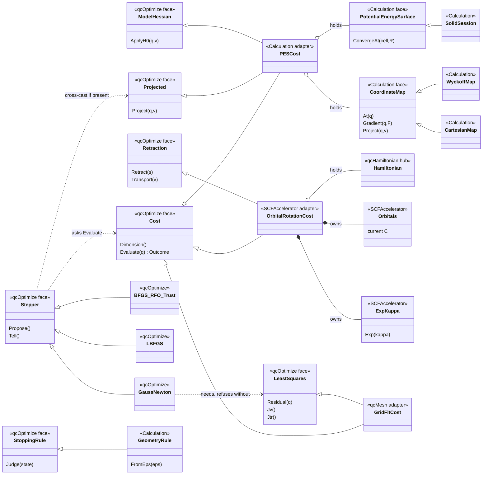
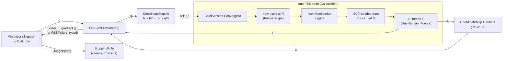

# V-OPTIMIZE-DIP: design note (lane H, 2026-11-09)

For the user, before any code.  **APPROVED 2026-11-09 (§9: all four decisions as recommended).**  Row: `doc/OOD-SOLID-Cleanup.md` V-OPTIMIZE-DIP.  Written from inside `GeometryOptimizer`: lane H
wrote `WyckoffMap` against it, wired `MakeSolidGeometryRun`, and found its roundoff defect (OpenWork §3, "GeometryOptimizer rejects
a roundoff-level energy rise").  Implementation is lane B's, later.

The row's three user rulings, which this note follows:
1. **Separate the algorithm from the cost** ("any algo can optimize any cost function").
2. **A small Math-level library, no chemistry in it**.  It is THE home of the interfaces, and qcHamiltonian (GDM) must see and use them.
3. **Adapter vs inheritance is decided on the MERITS**: a hub change is "a fleeting procedural annoyance".
4. **The faces are EMERGENT** (user, relayed 2026-11-09): "we make a best guess and refactor at will until we have at least two working
   SOLID::LSP optimizers. So not tier 1 for a while."  So every face below is a BEST GUESS that is expected to change: not a protected
   hub, no `hub-interfaces.snapshot` entry, refactored freely.  It hardens only when two real optimizers SUBSTITUTE for each other on
   one cost (LSP).  **The first pair to prove it: BFGS-RFO-trust (today's, moved) and L-BFGS on the SAME geometry cost** -- same cost,
   same rule, either algorithm, both converge.  Gauss–Newton then tests the `LeastSquares` face when grid tuning starts.

## The adapter, in one paragraph (and two pictures)

An ADAPTER is the small class that makes "a calculation plus a parameterisation" look like "a cost function", so neither the
calculation nor the minimizer knows about the other.  The minimizer only knows `Cost`: give it q, get back a value and a gradient.
The calculation only knows positions: give it R, get back E and forces.  `PESCost` sits between them: it HOLDS the calculation (a
`PotentialEnergySurface`) and a `CoordinateMap`, and its `Evaluate(q)` is three lines -- R = map.At(q), (E, F) = pes.ConvergeAt(R),
g = map.Gradient(q, F).  Swap the map (Wyckoff for Cartesian) and the minimizer sees a different cost without either side changing;
swap the minimizer (L-BFGS for BFGS) and the calculation never notices.  The orbital-rotation adapter does the same for GDM: it holds
the Hamiltonian, the current orbitals and the exp(κ) map, and makes "rotate the orbitals by κ" look like "a cost of κ".  The
alternative, inheritance, would make the calculation itself BE a cost (`PotentialEnergySurface : Cost`); §7 says why that is wrong
here: a calculation can be parameterised many ways, and a class can inherit only one.

**(a) Class associations** -- a hollow-triangle arrow (`<|--`) = inherits, is-a; a diamond (`o--` holds, `*--` owns) = has-a; the «stereotype» in each box names its library.



Read it as: the qcOptimize boxes know nothing below them; each adapter inherits the faces it can answer and HOLDS the chemistry it
answers them from.  No arrow points from qcOptimize down into Calculation, qcHamiltonian or qcMesh -- that is the dependency
inversion the row asks for.

**(b) Dataflow of one geometry evaluation**



GDM's evaluation has the same shape with the boxes renamed: κ → exp(κ) → C → D → Hamiltonian at fixed geometry → E, [F,D] → the
gradient in κ → the stepper; but the SCF LOOP, not the minimizer, calls it (§2, "two control styles").

## 0. What is welded today, and what is already cost-shaped

`GeometryOptimizer` (`src/Calculation/GeometryOptimizer.C`) is BFGS + RFO + trust radius, driving a `PotentialEnergySurface` through
a `CoordinateMap`.  Half the seam exists: the loop sees q, E and g only.  Four things are welded:
- **The evaluation**: `ConvergeAt(cell, R, {forces})` plus `map.Gradient(q, F)`, inlined in the loop.
- **The options**: `OptimizerOptions` mixes the CLIENT's stopping rule (max|g|, rms g, max step, ΔE, derived from ε by the geometry
  calibration) with the ALGORITHM's own knobs (trust radii, initial curvature).
- **The history row**: it carries `scfIterations`, a PES fact.
- **The step space**: `StepBasis` builds a DENSE n×n projector from `Project` and diagonalises it, O(n³) per step.  Fine for a geometry
  (n ≤ a few hundred); impossible for the grid tool's ~1e5 parameters.

The consumers the design must serve (their shapes differ, which is the point of the row):

| client | q | value / gradient | extra structure | who owns the loop |
|---|---|---|---|---|
| geometry (PES) | map coordinates, n ≤ 10²–10³ | E, −JᵀF; one SCF per point | a held subspace (rigid modes, polar origin); a model Hessian (Lindh) | the minimizer |
| grid tool (qcMesh) | quadrature parameters, up to ~10⁵ | ε measures vs a dense reference, gradient by Enzyme | least squares (residual + Jacobian); the site-group orbits ARE the parameters | the minimizer |
| GDM (SCFAccelerator) | orbital rotations κ | E[C exp(κ)], [F,D] | a manifold: exp(κ) and transport | the SCF LOOP (MOM, the Ladder's switches, the mixers) |
| later: NEB (FIRE), level-2 probe (Lanczos/dimer on Hv) | images; a direction | E, F | a band; curvature along v | the minimizer / the probe |

The last column decides §3.

## 1. The cost face and its capability faces

The library is qcOptimize (§6), namespace `qchem::Optimize`.  Every face is data-free and abstract (CLAUDE.md design rule).

```cpp
struct Want       { bool gradient = true; };              // a value-only ask (derivative-free, a line-search probe)
struct CostValue  { double value; rvec_t gradient; };     // gradient empty iff not asked
struct CostFailure{ std::string details; };               // what the ALGORITHM sees: the typed failure rides beside it (§2)

class Cost                                                // the one face every algorithm needs
{
public:
    virtual size_t Dimension() const = 0;
    virtual Outcome<CostValue, CostFailure> Evaluate(const rvec_t& q, const Want&) = 0;   // non-const: a PES advances its carried D
};
```

The capability faces sit BESIDE `Cost` (ISP).  An algorithm reaches one by a cross-cast between pure faces (CLAUDE.md cast rule):

| face | what it answers | absent means | who has it |
|---|---|---|---|
| `Projected` | `Project(q, v)`: the orthogonal projector onto the allowed step space at q, applied as an OPERATOR (never formed) | every direction is free | PES cost (from the map: rigid modes, polar origin); a symmetric grid cost if its parameters are not already orbit coordinates |
| `ModelHessian` | `ApplyH0(q, v)` or a dense `H0(q)` when n is small | H0 = c·1 from the algorithm's options | PES cost (Lindh through the map: Jᵀ H_R J) |
| `LeastSquares` | `Residual(q)` ∈ ℝᵐ, `J v`, `Jᵀ r` (matrix-free) | not a least-squares problem | the grid cost |
| `ValueNoise` | `Noise(q)`: a bound on the value's evaluation error (Ha for a PES) | exact to roundoff: c·ε_mach·\|value\| | PES cost (SCF ΔE gate + grid ε·N), grid cost |
| `Retraction` (later) | `Retract(s)`: move the cost's own base point along tangent s; `Transport(v)`: carry a tangent vector from the old base point to the new | Euclidean: q + s, transport = identity | the GDM orbital-rotation cost |

Notes:
- **`LeastSquares` IS-A cost by construction.**  Its value and gradient are ½‖r‖² and Jᵀr.  A small helper base derives `Evaluate` from
  `Residual`/`Jᵀr`, so the two cannot disagree.
- **`ValueNoise` is new beside the row's sketch.**  It is what the TrustCollapsed finding needs (§4), and it is a property of the cost,
  not of the client's tolerance: the SCF's ΔE gate, or the grid's delivered error, is what makes two evaluations of the same q differ.
- **Retraction, kept in tangent coordinates.**  The minimizer keeps working in a vector space: q is the tangent coordinate at the
  cost's current base point, and its quasi-Newton history is transported at each accepted step.  That is what GDM already does, with
  its BFGS in the rotated frame.  So the minimizer never adds a step to q itself on a manifold; it asks `Retract`.

## 2. The minimizer face, its failure, and two control styles

### The failure keeps the cost's own failure BY VALUE, typed, with no cast and no `std::any`

The algorithms are compiled ONCE, non-template, in qcOptimize; they see only `CostFailure`.  The client's typed failure (`PESFailure`)
rides on a thin template wrapper:

```cpp
template <class Fail> struct MinimizeFailure { Why why; std::string details; std::optional<Fail> cost; History history; };
template <class Fail> Outcome<Minimum, MinimizeFailure<Fail>> Minimize(tCost<Fail>&, Minimizer&, const StoppingRule&, rvec_t start);
```

`tCost<Fail>` is the client-facing face, whose `Evaluate` returns `Outcome<CostValue, Fail>`.  The wrapper adapts it to `Cost`,
parks the typed failure in a local optional, and reattaches it after the non-template algorithm returns.  `Why` keeps today's
values (`Cost`, `MaxSteps`, `TrustCollapsed`) and adds `MissingCapability`: an algorithm that needs a face the cost lacks REFUSES by
name, before the first evaluation ("Levenberg–Marquardt needs LeastSquares; this cost offers Cost, Projected").

### Two control styles, one algorithm

GDM cannot be driven by `Minimize(cost)`: the SCF loop owns the iteration (MOM, the Ladder's rung switches, held fills), and the
accelerator is CALLED by it (`UseFD`, then `NextOrbitals`).  The geometry and grid clients want the converse.  So each algorithm is
written once, as an ask/tell STEPPER:

```cpp
class Stepper    // one per run: the algorithm's state (H, history, trust radius)
{
public:
    virtual rvec_t Propose(const rvec_t& q, const CostValue& here) = 0;              // the next trial step
    virtual Verdict Tell(const rvec_t& step, const CostValue& there, double noise) = 0;   // Accept | Reject(retry with a new Propose)
};
```

`Minimize` is then a ~20-line driver: evaluate, Propose, evaluate, Tell, ask the rule, repeat.  The GDM accelerator holds a Stepper
and calls it from inside the SCF loop.  The merit: every algorithm serves both the pulled and the pushed client, so "any algo
optimizes any cost" holds for the one client that cannot hand over its loop.  This is the standard shape (Ceres's IterationCallback
and Optim.jl's state objects are the same idea).

### The algorithm families (the user's survey), and the capability each asks of the cost

The capability faces of §1 fall straight out of this table: each column the cost must answer is one face.  An algorithm asks for what
it needs and REFUSES by name when the cost lacks it (`MinimizeFailure::Why::MissingCapability`), before the first evaluation.

| family | algorithms | needs from the cost | first client |
|---|---|---|---|
| gradient-only (E, g) | steepest descent; CG (Polak–Ribière); BFGS + trust/RFO (today's, MOVED with §4's fixes); L-BFGS; FIRE | `Cost` (+ `Projected`, `ModelHessian`, `ValueNoise` used when present) | geometry (BFGS-RFO); grid at ~10⁵ and large cells (L-BFGS); NEB on rough surfaces (FIRE) |
| Hessian / Hessian-vector | trust-region Newton; Newton–CG | a `Curvature` face: `Hv(q, v)` (Enzyme gives it cheaply), or a dense H for small n | grid tool, once Enzyme Hv is gated |
| least squares (r, J) | Gauss–Newton; Levenberg–Marquardt (matrix-free CG on JᵀJ) | `LeastSquares` | the grid fit, which IS least squares |
| value-only | golden / Brent (1-D); Nelder–Mead; Bayesian optimisation (expensive values, ≲ 20 parameters) | `Cost` asked with `Want{gradient=false}` | a cost with no gradient yet (the MissingGradients analogue); a 1-D scan |
| manifold | Riemannian BFGS / CG | `Retraction` | the SCF's GDM over exp(κ); the ensemble finisher |
| constraints | projection (today's `CoordinateMap::Project`); penalty / augmented Lagrangian later | `Projected`; later a `Constraints` face (c(q), ∇c) | geometry (rigid modes, polar origin); a fixed-bond or fixed-volume scan later |

So §1's table gains ONE face, `Curvature` (Hv), for the Newton family.  It is listed, not built: it lands with its first client.

The Hv probe (Lanczos / dimer) is a SADDLE search, not a minimizer.  It would share `Cost` and `Projected` but is outside this row.

## 3. The stopping rule belongs to the client

```cpp
class StoppingRule { public: virtual Decision Judge(const IterationState&) const = 0; };   // Converged | Continue | Budget
struct GradientStepValue : StoppingRule { double maxGradient, rmsGradient, maxStep, valueChange; size_t maxIterations; };  // today's four tests
```

- The ALGORITHM's own knobs stay in its constructor: trust radii (initial / max / min), initial curvature, L-BFGS memory, LM damping.
  The rule never carries them.
- The GEOMETRY client builds the rule from ε through `ForceThresholdCalibration`.  That calibration stays in Calculation, the named
  calibration of CLAUDE.md "rigorous vs empirical".
- The grid client builds its own rule (the objective's own target).  GDM's rule is the SCF's (the loop's gates).
- An iteration cap is the CLIENT's budget, reported as `Budget`, as the SCF's NMaxIter is a failure of the SCF.

## 4. The roundoff-level energy rise (lane H's TrustCollapsed finding), folded in

**Measured** (UTCalculation `WyckoffMap.Rutile…`, model surface, 2026-11-09):
- the run converged to |g| ≈ 2e-9;
- the next trial's E then rose by roundoff (about 1e-15 relative), and today's rule `if (E1 > E) reject; trust *= 0.25` rejected it;
- each retry rose by roundoff again, so the radius fell to trustMin;
- the run then returned TrustCollapsed at a converged point.

The test now caps maxStep at 1e-4 so the rule stops first; the optimizer is unchanged (the OpenWork §3 row).  On a real PES the noise
is not 1e-15 but the SCF's ΔE gate, ~1e-8 Ha, so the same trap opens at |g| far above roundoff.

Three rules in the moved BFGS-RFO stepper, each its own named piece:
1. **A rise within the noise is not a rise.**  `Tell` rejects only when E1 − E > δ(q) + δ(q1), the two evaluations' `ValueNoise`
   bounds.  That is the RIGOROUS form: two independent errors, each bounded.  If a real PES's bound proves loose, the correction is a
   named calibration beside it (η = delivered / bound, with its measurement record), never a literal fudge in the comparison.
2. **The trust ratio is judged only above the noise.**  ρ = ΔE_actual / ΔE_predicted is meaningless when |ΔE_predicted| ≲ δ, so the
   radius is held there, neither grown nor cut.  Today it is cut, which is how the collapse runs.
3. **Every evaluated point is judged by the rule, accepted or not.**  A trial whose projected gradient meets the rule is a converged
   answer (return the lower-valued of it and the incumbent).  `TrustCollapsed` then means what it says: the radius fell below
   trustMin while the gradient did NOT meet the rule.

Gate: the rutile model at maxGradient 1e-8, WITHOUT the maxStep 1e-4 workaround, converges and reports Converged.  A model PES with
injected value noise of 1e-8 converges to its gradient threshold instead of collapsing.  The workaround is then removed from the
test, and the OpenWork row closes.

**As built (lane H, 2026-11-09, `07f5e89e5`): rule 3 for a REJECTED trial.**  Rule 1 already accepts a rise within the noise, so
a rejected trial has risen by MORE than the noise.  If its gradient still meets the rule, the gradient's zero is not the value's
minimum: the gradient carries noise above the threshold, or it is not the value's gradient.  Returning "the lower-valued of the two"
there would report convergence at a point the rule did not pass.  So that case is its own failure, `Failure::Why::GradientDisagrees`.
An accepted trial that meets the rule converges as written.  The model gate went into UTOptimize
`Minimize.ARiseWithinTheValueNoiseIsNotARise`: a one-signed (variational) value noise of 1e-6 on the soft-mode bowl.  Declared, the
run converges in 23 steps; the undeclared twin ends in TrustCollapsed at step 30.  At noise 1e-8 the undeclared twin ends in
GradientDisagrees at step 23.  A random-sign noise on a well-conditioned bowl did NOT separate the rules: BFGS converged before the
accepted points drifted to the low tail of the noise.

## 5. The factories wire the concrete pairs

Per CLAUDE.md, constructors demand concrete objects, and the factories hold every concrete association.
- **Calculation**: `MakeSolidGeometryRun` (landed in this lane today: a `SolidSession` and a `WyckoffMap` from ONE group,
  `SolidSetup::KeptOps`; P1 for a free setup) grows into `PESCost(PotentialEnergySurface&, const CoordinateMap&)`.
  - It implements `tCost<PESFailure>`, `Projected` (from the map), `ModelHessian` (Lindh through the map) and `ValueNoise` (the
    schedule's final-stage ΔE gate plus the grid's ε·N).
  - It is paired with the ε-derived rule and a BFGS-RFO stepper.
  - The algorithm choice (BFGS-RFO up to about 10³ parameters, L-BFGS above) is a POLICY: it reports itself under the run report's
    `policy` scope, with its reason.
  - `CoordinateMap`, `CartesianMap` and `WyckoffMap` stay in Calculation: they speak R, cells and forces, which is chemistry.
- **qcMesh grid tool**: `GridFitCost(quadrature parameters, dense reference)`, a `LeastSquares` cost whose gradient comes from
  Enzyme, FD-gated while Enzyme#3747 is open.
- **SCFAccelerator GDM** (last, its own note): `OrbitalRotationCost(Hamiltonian, current orbitals, LASolver)`, a `Retraction` cost
  driven through the Stepper by the SCF loop.

## 6. The library's place

**`qcOptimize` (`src/Optimize`), linking qcMath (Blaze, `rvec_t`) and qcCommon (`Outcome`, `Reporting`), nothing else.**
- qcMath alone cannot host it: it links nothing and `Outcome` lives in qcCommon.  `qchem.Math.DIIS` is the precedent for a shared
  numerical engine, but DIIS is an extrapolator with no failure path.
- The dependents are qcSCFAccelerator (GDM), qcMesh (the grid tool), qcHamiltonian (if a cost of D lands there, per the row) and
  Calculation.  qcOptimize depends on none of them, and the linker enforces that.
- Reporting follows CLAUDE.md: the CLIENT opens the scope (`report::Section("optimizer")`), and the algorithm writes its rows one
  level in (step, value, |g|, trust, accepted).  A client fact, such as a PES point's SCF iterations, is written by the cost
  adapter in its own `Evaluate`, inside the same row.  The history then needs no client field.

## 7. Adapter vs inheritance, on the merits

**Inheritance** would be `PotentialEnergySurface : Cost`, or `Hamiltonian : Cost`.  Against it:
- **A cost is a function of its PARAMETERS.**  The same PES is minimised over Wyckoff q, over Cartesian q, and later over cell
  constants or internals.  The same Hamiltonian is minimised over κ (GDM) and, in another view, over D.  A class can inherit `Cost`
  for one parameterisation only, so the others would be adapters anyway: two shapes for one concept.
- **The PES's contract is richer** (cell, request, `PESFailure`) and would be narrowed or leaked through `Evaluate(q)`.
- **The Hamiltonian is one ingredient, not the cost.**  E(R) = min_D E[D;R] needs a new basis, new grids, a new Hamiltonian
  instance and a re-converged SCF at every point.  The Hamiltonian supplies the fixed-D pieces (term forces + Pulay), which equal
  dE/dR only because D is variational there.  Under κ the Hamiltonian is held fixed while the orbitals rotate.  In both cases the
  cost is a COMPOSITE.

**Adapter.**  The parameterisation lives exactly where the composite is assembled: `PESCost` holds PES + map, `OrbitalRotationCost`
holds Hamiltonian + orbitals + exp(κ), `GridFitCost` holds sampler + reference.  The capabilities fall out of what the adapter holds:
`Projected` and `ModelHessian` from the map, `Retraction` from exp(κ), `LeastSquares` from the residual.

**Where inheritance IS right:** a class whose natural parameters are q and that has no other parameterisation.  The model surfaces
in the unit tests are the example: they implement `Cost` directly.

**Verdict: ADAPTER.**  No hub changes.  (That is a consequence, not the argument.)

## 8. Migration (lane B), each step green on its own

1. ✅ (lane H, 2026-11-09, `07f5e89e5`; owner moved from lane B to lane H by the controller for steps 1–3) Create qcOptimize (faces EMERGENT, ruling 4: no hub snapshot) with: `Cost`, `Projected`, `ModelHessian`, `ValueNoise`, `StoppingRule`, `Stepper` + `Minimize`, and the
   BFGS-RFO stepper MOVED with §4's three rules.  Its unit tests: today's model surfaces (bowl, Rosenbrock, soft mode, noise),
   moved down from `UTCalculation` to `UTOptimize` (CLAUDE.md: unit over integration).
2. ✅ (lane H, 2026-11-09, `7bbeb3647`; the TrustCollapsed row CLOSED) `GeometryOptimizer` becomes a thin client: `PESCost` + the ε rule + `Minimize`.  `OptimizedGeometry` and `OptimizeFailure` become
   `Minimum` and `MinimizeFailure<PESFailure>` plus the geometry.  The Wyckoff / Cartesian gates stay in `UTCalculation`.  Remove the
   rutile maxStep workaround.
3. ✅ (lane H, 2026-11-09, `03e7d4f96`) L-BFGS on the SAME `PESCost` as BFGS-RFO: the first LSP proof of the emergent base (ruling 4).  Gate: every model-surface test
   runs under both steppers with no change to the cost or the rule; where the faces had to bend for L-BFGS, bend them now (still
   not a hub).
   **As built.**  No face had to bend: L-BFGS implements the same `Stepper` and reads the same `Cost`, `Projected` and
   `ValueNoise`.  It does not use `ModelHessian` (it would need the inverse), which the face allows ("used when present").
   - **Shared code:** the trust radius and §4 rules 1-2 moved into `TrustRegion`, so the pair judge a rise identically.
   - **Gates:** every model gate runs under both steppers with no change to a cost or a rule: UTOptimize `Minimize/BothSteppers.*`;
     UTCalculation `GeometryOptimizerBoth.*` and `WyckoffMapBoth.*`, rutile and wurtzite through `PESCost`.
   - **Measured (BFGS-RFO / L-BFGS):** bowl 11 / 12, Rosenbrock 35 / 48, soft mode 23 / 19.
   - **One claim did not survive the swap:** "a threshold below the gradient noise ENDS IN A FAILURE".  L-BFGS converged exactly at the
     noisy gradient's zero.  The algorithm-invariant claim is the pair: a failure, or the noisy zero, never the minimum.
   - **The algorithm choice:** `OptimizerOptions::Algorithm::Auto` is a reported policy (`GeometryOptimizer.Algorithm`): BFGS-RFO up to
     10³ parameters, L-BFGS above.
   - **Ruling 4's condition is now MET** (two LSP-substitutable optimizers on one cost).  Whether the faces now harden (a hub, a
     snapshot) is the user's call; until then they stay emergent.
4. `LeastSquares` + Levenberg–Marquardt, with the grid tool.
5. GDM onto the Stepper + `Retraction`: the riskiest step (the SCF panel moves).  It gets its own note first.

## 9. Decisions for the user -- RULED 2026-11-09: all four as recommended

**User ruling (controller relay, 2026-11-09): "I agree on 1,2,3,4".**  The design is APPROVED; lane B implements it per §8.
- (1) **Adapter**: the cost is a composite (PES × `CoordinateMap`; Hamiltonian + orbitals + exp(κ)), held by the minimizer only
  through the cost face.
- (2) **A new `qcOptimize` library**, depending on qcMath + qcCommon only; no chemistry in it.
- (3) **The ask/tell `Stepper` is each algorithm's primitive**, and `Minimize` is the driver over it.
- (4) **The value noise is a COST capability** (`ValueNoise`), not a tolerance in the client's stopping rule.

The faces stay EMERGENT (ruling 4 above): no tier-1 hub and no `hub-interfaces.snapshot` entry, until BFGS-RFO and L-BFGS are
LSP-substitutable on the same `PESCost` (§8 step 3).

The questions as put to the user:

1. **Adapter** (recommended, §7 and the two diagrams) or inheritance.
2. **A new `qcOptimize` library** (recommended, §6) or a module inside qcMath, which would make qcMath link qcCommon.
3. **The ask/tell `Stepper` as each algorithm's primitive** (recommended, §2; the only shape GDM can use), or `Minimize(cost)` only
   and GDM stays as it is.
4. **The value noise as a COST capability** (recommended, §4) or a tolerance in the client's stopping rule.
